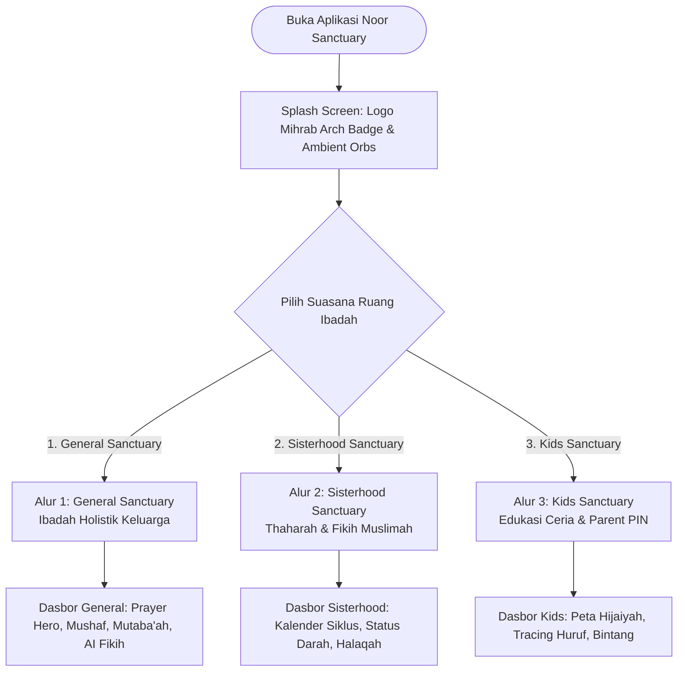
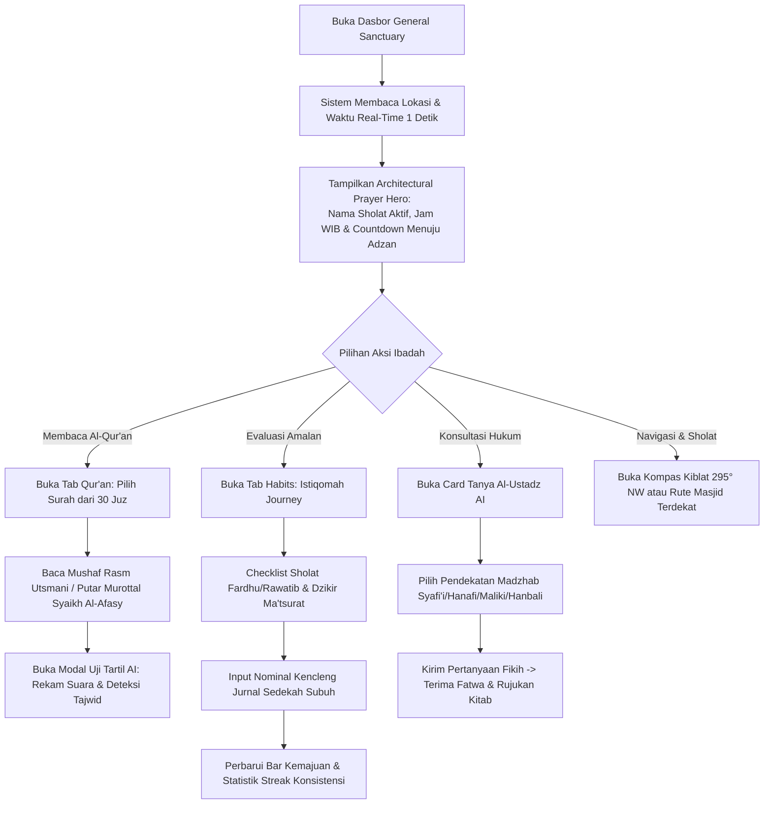

# PROPOSAL DESAIN APLIKASI AL-QUR'AN (DAQ)
## ISLAMIC YOUTH FESTIVAL V (IYF V) 2026
**STT Terpadu Nurul Fikri**

---

**TEMA UTAMA:**  
*"The Islamic Renaissance: Inspired by the Past, Building the Future"*

**SUB-TEMA KARYA:**  
1. **Inklusi & Peradaban Digital (Social Impact & Inclusive Tech):** Solusi Gaya Hidup Halal (*Halal Lifestyle*) Terpadu dan Aksesibilitas Lintas Generasi.
2. **Inovasi Pembelajaran Masa Depan (Future Education & AI):** Pemanfaatan *Artificial Intelligence* dan Gamifikasi Interaktif dalam Pembelajaran Al-Qur'an.
3. **Digitalisasi Khazanah Islam (Past to Future):** Preservasi dan Digitalisasi Rujukan Fikih Klasik Empat Madzhab serta Silsilah Sanad Hadits.

---

# NOOR SANCTUARY: EKOSISTEM GAYA HIDUP ISLAMI & PEMBELAJARAN AL-QUR'AN TERPADU BERBASIS ADAPTIVE MULTI-SANCTUARY MODE DAN AI FIKIH MULTIMADZHAB

---

**Disusun Oleh: Tim Pengembang Noor Sanctuary**

| Posisi Tim | Nama Anggota | NIM | Program Studi | Perguruan Tinggi |
| :--- | :--- | :--- | :--- | :--- |
| **Ketua Tim** | Akmal Bagus Priambodo | 0110222001 | Teknik Informatika | STT Terpadu Nurul Fikri |
| **Anggota** | Ihsan Ahmad | 0110122045 | Sistem Informasi | STT Terpadu Nurul Fikri |

---

### CATATAN FORMAT & LEGALITAS DOKUMEN
* **Standar Format:** Dokumen proposal ini disusun mengacu pada ketentuan resmi panitia IYF V:
  * Ukuran Kertas: A4 (210 mm x 297 mm)
  * Jenis Huruf: Times New Roman 12 pt (dengan hirarki proporsional untuk judul dan tabel)
  * Kerapatan Spasi Baris: 1.15 pt
  * Target Ketebalan: 8 – 10 Halaman Standar Dokumen Kompetisi
* **Orisinalitas Karya:** Karya aplikasi dan desain sistem ini bersifat orisinal, merupakan rancangan mandiri tim pengembang, dan belum pernah menjuarai kompetisi sejenis di tingkat lokal, nasional, maupun internasional.

---

## 1. JUDUL APLIKASI

**NOOR SANCTUARY: EKOSISTEM GAYA HIDUP ISLAMI & PEMBELAJARAN AL-QUR'AN TERPADU BERBASIS ADAPTIVE MULTI-SANCTUARY MODE DAN AI FIKIH MULTIMADZHAB**

*Nama Singkat Produk:* **Noor Sanctuary**  
*Deskripsi Identitas Aplikasi:* **"Ruang Digital Ibadah • Khazanah Qolbu"**  
*(Noor Sanctuary: An Integrated Islamic Lifestyle & Qur'anic Learning Ecosystem Powered by Adaptive Multi-Sanctuary Architecture and Multi-Madzhab Fiqh Intelligence)*

---

## 2. LATAR BELAKANG (MASALAH YANG DISELESAIKAN)

### 2.1 Konteks Spiritualitas dan Distraksi Era Digital
Peradaban modern menempatkan gawai pintar (*smartphone*) sebagai pintu gerbang pertama yang diakses oleh seorang muslim dalam mengawali harinya. Namun, lanskap digital kontemporer didominasi oleh algoritma media sosial dan aplikasi komersial yang sengaja dirancang untuk memperebutkan atensi (*attention economy*), bukan untuk merawat ketenangan batin (*thuma’ninah*) maupun menumbuhkan keistiqamahan ibadah. Akibatnya, paparan arus informasi mikro yang instan dan adiktif melahirkan fenomena penurunan rentang konsentrasi secara drastis (*information overload*). Kondisi ini mengikis kontinuitas *mutaba'ah yaumiyah* (evaluasi amalan harian), padahal Rasulullah saw. menegaskan bahwa amalan yang paling dicintai Allah Swt. adalah amalan yang berkesinambungan (*kontinu*) meskipun sedikit:

$$\text{"Amalan yang paling dicintai oleh Allah adalah amalan yang kontinu (istiqamah) walaupun sedikit." (HR. Al-Bukhari No. 6464 dan Muslim No. 783)}$$

Kebutuhan generasi muslim urban modern saat ini sejatinya bukan terletak pada kurangnya informasi, melainkan ketiadaan ruang digital yang tenang, terarah, inklusif, dan terpercaya (*a trusted spiritual sanctuary*).

### 2.2 Kesenjangan Masalah pada Aplikasi Islami Eksisting (*Problem Gap*)
Berdasarkan telaah kritis terhadap aplikasi-aplikasi Islami yang beredar di pasar global maupun nasional, ditemukan empat kesenjangan mendasar (*problem gaps*):
1. **Monolitisme Desain Tanpa Personalisasi Segmentasi (*One-Size-Fits-All Issue*):**  
   Mayoritas aplikasi Al-Qur'an menerapkan antarmuka tunggal kaku untuk seluruh pengguna. Desain ini mengabaikan perbedaan biologis dan fase spiritualitas. Contoh nyata: kebutuhan muslimah dalam memantau siklus *thaharah* (haid, nifas, istihadhah) terabaikan di dalam aplikasi ibadah utama, sehingga muslimah merasa "terasing" dari ibadah saat berhalangan. Di sisi lain, anak-anak usia dini disuguhi antarmuka dewasa yang padat teks tanpa panduan fonetik dan motorik, serta berisiko terpapar konten atau interaksi yang tidak sesuai usianya.
2. **Komersialisasi Iklan yang Mengikis Kesucian Ibadah:**  
   Banyak aplikasi Al-Qur'an populer menyisipkan iklan banner komersial, pop-up video gim, hingga pelacak data lokasi pihak ketiga (*third-party ad trackers*). Munculnya iklan vulgar atau mengganggu di tengah-tengah lantunan ayat suci menjadi keluhan luas yang merusak kekhusyukan dan mencoreng etika berinteraksi dengan mushaf.
3. **Kekosongan Asisten Fikih Interaktif yang Bersanad dan Terpercaya (*Trusted Fiqh AI Vacuum*):**  
   Ketika masyarakat menghadapi keraguan hukum praktis harian (misal: hukum tetes mata saat puasa, batas maksimal darah haid, jamak-qashar safar), mereka kerap mencari jawaban secara instan melalui media sosial atau chatbot AI publik. Chatbot generik rentan berhalusinasi, tidak mampu menyajikan perbandingan madzhab secara objektif, dan tidak memiliki rujukan dalil dari kitab-kitab *mu'tamad*.
4. **Ketiadaan Integrasi Ekosistem Habituasi Ibadah Holistik:**  
   Sebagian besar aplikasi Al-Qur'an hanya bertindak sebagai dokumen teks digital statis. Tidak ada ekosistem terpadu yang menyatukan tilawah, evaluasi sholat fardhu-rawatib, kencleng digital sedekah subuh, dan edukasi sanad keilmuan dalam satu aplikasi terintegrasi.

### 2.3 Landasan Normatif Al-Qur'an dan As-Sunnah
Noor Sanctuary dibangun di atas pijakan dalil syar'i yang kokoh. Al-Qur'an adalah pedoman sempurna bagi seluruh dimensi kehidupan:

$$\text{إِنَّ هَٰذَا الْقُرْآنَ يَهْدِي لِلَّتِي هِيَ أَقْوَمُ}$$
$$\text{"Sungguh, Al-Qur'an ini memberikan petunjuk ke (jalan) yang paling lurus..." (QS. Al-Isra [17]: 9)}$$

Perintah menjaga kesucian diri dan thaharah ditegaskan oleh Allah Swt.:

$$\text{إِنَّ اللَّهَ يُحِبُّ التَّوَّابِينَ وَيُحِبُّ الْمُتَطَهِّرِينَ}$$
$$\text{"Sungguh, Allah menyukai orang yang bertobat dan menyukai orang yang menyucikan diri." (QS. Al-Baqarah [2]: 222)}$$

Adapun mengenai kewajiban merujuk kepada otoritas ilmu yang benar:

$$\text{فَاسْأَلُوا أَهْلَ الذِّكْرِ إِن كُنتُمْ لَا تَعْلَمُونَ}$$
$$\text{"Maka bertanyalah kepada orang yang berilmu jika kamu tidak mengetahui." (QS. An-Nahl [16]: 43)}$$

Rasulullah saw. bersabda: *"Sebaik-baik kalian adalah yang mempelajari Al-Qur'an dan mengajarkannya."* (HR. Al-Bukhari). Hadits ini menjadi landasan moral untuk mendemokratisasi akses pembelajaran Al-Qur'an bagi seluruh anggota keluarga melalui instrumen teknologi modern.

### 2.4 Manifestasi "The Islamic Renaissance: Inspired by the Past, Building the Future"
* **Inspired by the Past (Pijakan Tradisi Keilmuan Klasik / Turats):**  
  Menghidupkan kembali khazanah keilmuan emas Islam melalui digitalisasi rujukan fikih empat madzhab Ahlussunnah wal Jama'ah (*Syafi'i, Hanafi, Maliki, Hanbali*) yang bersumber langsung dari kitab *mu'tamad* (seperti *Fathul Qarib Al-Mujib*, *Al-Majmu' Syarah Al-Muhadzdzab*, *Bidayatul Mujtahid*, dan *Majmu' Fatawa*), silsilah rantai sanad hadits muttashil, serta sirah 25 Nabi.
* **Building the Future (Penerapan Rekayasa Teknologi Masa Depan):**  
  Mengimplementasikan *Adaptive Triple-Sanctuary Architecture* pada Flutter multiplatform, penalaran fikih berbasis *Retrieval-Augmented Generation (RAG)*, komputasi astronomis hisab waktu sholat berlatensi nol, serta gamifikasi edukatif anak yang dilindungi gerbang keamanan *Parent PIN Lock 4-digit*. Peradaban Islam abad pertengahan melahirkan ilmuwan besar seperti Al-Khawarizmi yang namanya mengabadi dalam istilah "algoritma"; Noor Sanctuary hadir untuk melanjutkan estafet tersebut: menghadirkan algoritma modern yang berpihak pada adab, dakwah, dan kesucian ibadah.

---

## 3. TUJUAN DAN MANFAAT

### 3.1 Tujuan Umum
Menghadirkan ekosistem digital Islami terpadu yang inklusif, bebas distraksi iklan, dan berlandaskan prinsip *Maqashid Syariah* (menjaga agama/hifdz ad-din, jiwa/hifdz an-nafs, akal/hifdz al-'aql, keturunan/hifdz an-nasl, dan harta/hifdz al-mal) untuk mendampingi pembelajaran Al-Qur'an dan habituasi gaya hidup halal bagi seluruh keluarga muslim.

### 3.2 Tujuan Khusus
1. **Arsitektur Teknologi Adaptif Inklusif:** Membangun sistem *Triple Adaptive Sanctuary* (General, Sisterhood, Kids) dalam satu aplikasi tunggal yang dapat dialihkan secara instan dengan waktu transisi $\le 2$ detik.
2. **AI Fikih Beradab & Bersanad:** Mengembangkan asisten fikih interaktif multi-madzhab dengan arsitektur RAG yang menjamin 100% respons menyertakan rujukan kitab mu'tamad dan menolak menjawab jika tidak ditemukan basis dalil yang sahih.
3. **AI Pendamping Pelafalan Tilawah:** Merancang modul evaluasi tajwid dan makhraj berbasis kecerdasan buatan untuk mendukung latihan mandiri talaqqi hafalan Al-Qur'an Juz 'Amma (37 Surah).
4. **Pembiasaan Mutaba'ah & Muamalah Harian:** Menyediakan pelacak amalan sholat fardhu, rawatib, dzikir ma'tsurat, dan Jurnal Kencleng Sedekah Subuh guna membangun konsistensi spiritual harian.
5. **Edukasi Al-Qur'an Usia Dini & Proteksi Anak:** Menyajikan kurikulum huruf Hijaiyah interaktif bersuara makhraj dan kanvas *tracing* motorik yang diproteksi fitur keamanan *Parent PIN Lock 4-digit*.

### 3.3 Manfaat Aplikasi
* **Bagi Pengguna Umum:** Memperoleh ruang ibadah digital yang tenang (*tranquil sanctuary*), mushaf 30 juz ber-rasm Utsmani, hisab sholat presisi, kompas Ka'bah 295° NW, dan konsultasi fikih berdasar perbandingan madzhab.
* **Bagi Muslimah:** Memperoleh kepastian hukum status darah thaharah (haid, suci, istihadhah, nifas) secara otomatis tanpa kekhawatiran salah menghitung masa sholat, serta ruang halaqah yang aman.
* **Bagi Anak dan Orang Tua:** Anak mendapatkan media stimulasi Al-Qur'an yang ceria dan bebas dari konten berbahaya, sementara orang tua memiliki kendali penuh atas durasi dan navigasi aplikasi melalui PIN proteksi.
* **Bagi Peradaban Digital:** Menjadi preseden bahwa teknologi Islami dapat dibangun secara profesional, bebas dari eksploitasi komersialisasi iklan kotor, dan menjunjung tinggi kedaulatan privasi data (*privacy-first*).

---

## 4. BATASAN APLIKASI (RUANG LINGKUP)

1. **Target Pengguna (Multi-Generasi):**  
   * *General Sanctuary:* Muslim/Muslimah usia 15–60 tahun (pelajar, mahasiswa, akademisi, dan profesional).
   * *Sisterhood Sanctuary:* Remaja putri dan wanita muslimah usia 12–50 tahun.
   * *Kids Sanctuary:* Anak usia dini 4–10 tahun di bawah kendali dan bimbingan orang tua.
2. **Platform & Kesiapan Perangkat Lunak:**  
   * Basis kerangka kerja: Flutter SDK (Dart 3) dengan arsitektur multi-platform (Android, iOS, Web, Windows).
   * Tata letak responsif dua kolom (*architectural layout*) untuk layar lebar/desktop ($\ge 850\text{ px}$) dan satu kolom ergonomis untuk perangkat telepon pintar (*mobile*).
3. **Batasan Konten Al-Qur'an & Tilawah:**  
   * Teks Al-Qur'an 30 Juz standar Kementerian Agama RI ber-rasm Utsmani 15 baris, dilengkapi terjemahan bahasa Indonesia resmi dan audio murottal qari internasional Syaikh Misyari Rasyid Al-Afasy.
   * Purwarupa saat ini mengimplementasikan dataset 18 surah sampel lengkap dengan audio per ayat/surah, dengan target ekspansi penuh 114 surah. Analisis suara AI difokuskan pada Juz 'Amma (Surah ke-78 hingga ke-114).
4. **Batasan Fikih Thaharah Muslimah:**  
   * Algoritma penghitungan siklus darah mengacu pada qaul *mu'tamad* Mazhab Imam Asy-Syafi'i (batas minimal haid 24 jam, batas maksimal 15 hari 15 malam, dan batas suci minimal 15 hari).
5. **Batasan Modul Kids Hijaiyah:**  
   * Menampilkan katalog 28 huruf Hijaiyah lengkap; pada purwarupa rilis perdana difokuskan pada 8 huruf awal (Alif sampai Dal) dengan fitur suara makhraj, kanvas *tracing*, dan kuis bintang berkah.
6. **Batasan Kecerdasan Buatan (AI Engine):**  
   * AI bertindak sebagai asisten literasi fikih harian edukatif dan bukan penerbit fatwa baru. Kasus kontemporer kompleks tetap diarahkan untuk bertalaqqi kepada ulama setempat. Pada purwarupa saat ini, respons AI dan analisis suara tajwid dijalankan melalui modul responder simulasi berbasis aturan (*rule-based simulator*).
7. **Inklusi & Aksesibilitas Disabilitas:**  
   * Rilis perdana mengimplementasikan kontras visual tinggi (standar WCAG AAA), tipografi adaptif, dan tata letak bebas distraksi. Mode pembaca layar (*screen-reader TalkBack/VoiceOver*) dan mode *audio-first* dirancang pada roadmap integrasi berikutnya.
8. **Di Luar Batasan (Out-of-Scope):**  
   * Bebas dari segala bentuk iklan komersial pihak ketiga (*zero ads*), tidak ada media sosial terbuka tanpa kurasi bagi anak-anak, dan tidak menjual data riwayat pengguna ke pihak manapun.

---

## 5. METODE & ANALISIS PASAR

### 5.1 Metode Pengembangan Perangkat Lunak
Pengembangan aplikasi Noor Sanctuary mengadopsi model **Agile – Incremental Development** yang terbagi ke dalam empat sprint berkesinambungan:

```
┌────────────────────────────────────────────────────────┐
│ Sprint 1: Riset, Persona & Formulasi Kaidah Fikih      │ (Selesai)
└──────────────────────────┬─────────────────────────────┘
                           ▼
┌────────────────────────────────────────────────────────┐
│ Sprint 2: UI/UX & Prototyping (Figma & Google Stitch)  │ (Selesai - 68 Layar)
└──────────────────────────┬─────────────────────────────┘
                           ▼
┌────────────────────────────────────────────────────────┐
│ Sprint 3: Pengkodean Flutter & Integrasi AI Simulator   │ (Selesai - ±42k Baris Dart)
└──────────────────────────┬─────────────────────────────┘
                           ▼
┌────────────────────────────────────────────────────────┐
│ Sprint 4: Pengujian Usability (SUS) & Validasi Ahli    │ (Tahap Rencana Validasi)
└────────────────────────────────────────────────────────┘
```

1. **Sprint 1 — Riset Kebutuhan & Formulasi Kaidah Syar'i:** Mengidentifikasi kebutuhan tiga persona (umum, muslimah, anak), merumuskan algoritma hisab thaharah berlandaskan literatur fikih, dan menyusun dataset Al-Qur'an serta waktu sholat.
2. **Sprint 2 — Perancangan UI/UX & Sistem Desain (Telah Selesai):** Merancang sistem desain *"Ethereal Islamic Sanctuary"*, menyusun arsitektur informasi, serta membangun purwarupa *high-fidelity* 68 layar interaktif di Figma dan Google Stitch.
3. **Sprint 3 — Rekayasa Perangkat Lunak Flutter (Telah Selesai pada Lapisan Antarmuka):** Mengimplementasikan kode Flutter fungsional (mencapai $\pm 42$ ribu baris kode Dart dalam 56 berkas layar), mengintegrasikan *state management*, kanvas sentuh *tracing*, timer jam real-time, dan simulator AI Tanya Ustadz.
4. **Sprint 4 — Pengujian Kegunaan & Uji Syariah (Tahap Rencana):** Pengujian usabilitas sistem menggunakan kuesioner *System Usability Scale (SUS)* kepada perwakilan persona, serta telaah validitas hukum fikih dan tajwid bersama asatidz pembina.

### 5.2 Analisis Pasar & Keunggulan Kompetitif (*Market Analysis & UVP*)
Tabel berikut membedah posisi tawar Noor Sanctuary dibandingkan produk kompetitor utama:

| Parameter Evaluasi | Kompetitor A (Muslim Pro) | Kompetitor B (Umma / Kesan) | **NOOR SANCTUARY (UVP Tim Kami)** |
| :--- | :--- | :--- | :--- |
| **Model Adaptasi Antarmuka** | Antarmuka umum tunggal (*one-size-fits-all*). | Linimasa feed sosial umum. | **Triple Adaptive Sanctuary:** Beralih instan antara mode General, Sisterhood, dan Kids. |
| **Fikih Thaharah Muslimah** | Tidak tersedia (hanya kalender siklus generik). | Artikel teks fikih wanita statis. | **Sisterhood Workspace:** Pelacak otomatis status Haid, Suci, Mandi Wajib, Nifas, dan Istihadhah (Madzhab Syafi'i). |
| **Edukasi Al-Qur'an Anak** | Tidak ada ruang khusus anak. | Kanal video kartun pasif. | **Kids Safe Sanctuary:** Tracing kanvas sentuh huruf, audio makhraj cilik, celengan bintang, dan **Parent PIN Lock 4-Digit**. |
| **Asisten AI Fikih** | Tidak tersedia / pencarian teks biasa. | Tanya ustadz manual (waktu tunggu berhari-hari). | **Tanya Al-Ustadz AI Multimadzhab:** Jawaban instan dengan perbandingan 4 madzhab dan sitasi kitab *mu'tamad*. |
| **Mutaba'ah & Sedekah** | Checklist sederhana tanpa kustomisasi satuan. | Log checklist amalan standar. | **Istiqomah Journey & Jurnal Sedekah:** Evaluasi sholat, dzikir, tilawah ber-streak, serta kencleng digital sedekah subuh. |
| **Etika Monetisasi & Iklan** | Sangat padat iklan pop-up dan banner komersial. | Ketergantungan iklan pada versi gratis. | **Privacy-First & Zero Distraction:** Bersih dari iklan komersial distraktif, menjunjung kekhusyukan dan privasi data. |
| **AI Tilawah & Gamifikasi** | Terbatas pada pemutar audio. | Terbatas pada tantangan khatam. | **AI Tartil Voice Mic & Khazanah Games:** Uji makhraj tajwid interaktif dan petualangan sirah nabawiyah. |

### 5.3 Keselarasan Terhadap Kriteria Penilaian Panitia IYF V
1. **Aspek Inovasi:** Menghadirkan adaptabilitas multi-persona (*Triple Sanctuary*) pertama di Indonesia, RAG AI Fikih multimadzhab bersitasi, dan integrasi Parent PIN ramah anak.
2. **Dampak Penggunaan:** Menjawab kebutuhan spesifik tiga generasi keluarga muslim tanpa harus mengunduh 3–4 aplikasi terpisah.
3. **Potensi Keberlanjutan:** Fitur *Istiqomah Journey*, gamifikasi kuis sirah, dan pembaruan berkala kajian majelis ta'lim menciptakan retensi organik tanpa bergantung pada notifikasi spam.
4. **Antarmuka & Kemudahan Penggunaan:** Desain Material 3 berestetika tinggi, navigasi intuitif lima tab, dan waktu muat transisi antar-mode instan.
5. **Metode Rekayasa Perangkat Lunak:** Dikerjakan dengan metodologi terukur (*Agile-Incremental*), manajemen kode modular, dan pengujian terstruktur.
6. **Kesesuaian Kandungan Al-Qur'an:** Menjunjung tinggi keotentikan mushaf standar Kemenag RI, kelengkapan audio qari bersanad, tadabbur tematik, serta bimbingan fikih sesuai sunnah.

---

## 6. PERANCANGAN SISTEM (DESIGN)

### 6.1 Use Case Diagram Lengkap
Sistem Noor Sanctuary melibatkan empat aktor pengguna dengan relasi generalisasi, serta satu aktor sistem internal (Admin/Pakar Fikih):
* **Pengguna Umum:** Mengakses seluruh fitur ibadah universal (UC1–UC9).
* **Muslimah:** Merupakan spesialisasi dari Pengguna Umum (*generalisasi*), mewarisi seluruh UC1–UC9 ditambah fitur khusus pelacakan siklus thaharah (UC10).
* **Anak:** Berinteraksi dalam ruang aman Kids Sanctuary untuk belajar huruf Hijaiyah, tracing, dan mengumpulkan bintang kuis (UC11, UC12).
* **Orang Tua:** Berinteraksi untuk mengaktifkan Kids Mode, memverifikasi Parent PIN, dan mengatur batas waktu pemakaian layar (UC13). Upaya keluar dari Kids Mode (UC1) wajib melalui verifikasi PIN (UC13).
* **Admin / Pakar Fikih:** Mengelola korpus kitab RAG AI, meninjau jawaban fikih, serta memvalidasi konten khazanah dan naskah syiar (UC14, UC15).

```mermaid
flowchart LR
    subgraph Aktor Pengguna & Sistem
        U["Pengguna Umum"]
        M["Muslimah\n(Generalisasi Pengguna Umum)"]
        K["Anak (Kids)"]
        P["Orang Tua (Parent)"]
        A["Admin / Pakar Fikih"]
    end

    subgraph Noor Sanctuary (System Boundary)
        UC1["UC1: Memilih & Berganti Sanctuary Mode"]
        UC2["UC2: Melihat Jadwal Sholat, Countdown & Kiblat 295°"]
        UC3["UC3: Membaca & Mendengar Mushaf Al-Qur'an 30 Juz"]
        UC4["UC4: Setor Bacaan & Uji Pelafalan AI Tajwid"]
        UC5["UC5: Mutaba'ah Yaumiyah & Jurnal Sedekah Subuh"]
        UC6["UC6: Konsultasi Fikih pada Tanya Al-Ustadz AI"]
        UC7["UC7: Membaca Khazanah Hadits & Kirim Kontribusi"]
        UC8["UC8: Bermain Khazanah Games & Kuis Sirah"]
        UC9["UC9: Menonton Reels Syiar & Majelis Streaming"]
        UC10["UC10: Melacak Siklus Thaharah & Fiqih Nisa"]
        UC11["UC11: Belajar Hijaiyah, Audio Makhraj & Tracing"]
        UC12["UC12: Menyelesaikan Tes Iqra & Kumpul Bintang"]
        UC13["UC13: Verifikasi Parent PIN Lock 4-Digit"]
        UC14["UC14: Mengelola Korpus Fikih & Review Jawaban AI"]
        UC15["UC15: Meninjau Kontribusi Syiar & Kelola Konten"]
    end

    U --> UC1
    U --> UC2
    U --> UC3
    U --> UC4
    U --> UC5
    U --> UC6
    U --> UC7
    U --> UC8
    U --> UC9

    M -.->|generalisasi| U
    M --> UC10

    K --> UC11
    K --> UC12

    P --> UC13
    UC1 -.->|include jika dari Kids| UC13

    A --> UC14
    A --> UC15
```

---

### 6.2 Alur Pengguna Mendalam Berdasarkan 3 Mode Utama (*User Flow*)
Sesuai rancangan arsitektur sistem, navigasi aplikasi berpusat pada penyesuaian suasana ibadah (*Sanctuary Mode Switcher*) yang kemudian mengalirkan pengguna ke tiga alur spesifik:



---

#### Skenario 1 — Alur Mode Utama 1: General Sanctuary (Ibadah Holistik & Mutaba'ah)
Alur ini dirancang bagi masyarakat muslim umum untuk mengawal ritme ibadah harian dari waktu ke waktu secara presisi:



---

#### Skenario 2 — Alur Mode Utama 2: Sisterhood Sanctuary (Fikih Thaharah & Muslimah)
Alur ini memfasilitasi kebutuhan unik muslimah dalam menentukan batas suci, status darah, serta mendapatkan amalan alternatif syar'i:

```mermaid
flowchart TD
    S1[Buka Dasbor Sisterhood Sanctuary] --> S2[Tampilkan Ring Siklus Thaharah:\nContoh: Hari ke-4 dari Estimasi 7 Hari]
    S2 --> S3{Aksi Pengguna Muslimah}
    
    S3 -->|Perbarui Status Harian| S4[Buka Layar Catat Siklus Thaharah]
    S4 --> S5{Pilih Kondisi Darah}
    
    S5 -->|Mulai Haid| S6[Catat Jam/Tanggal Mulai\nSistem Menonaktifkan Target Sholat\nMenampilkan Amalan Pengganti: Dzikir, Murottal, Sedekah]
    S5 -->|Darah Berhenti| S7[Kalkulasi Syarat Suci\nTampilkan Panduan Mandi Wajib & Doa Thaharah\nAktifkan Kembali Pengingat Sholat]
    S5 -->|Flek / Istihadhah| S8[Algoritma Mengecek Masa Siklus: Apakah > 15 Hari?\nIdentifikasi Darah Istihadhah\nTampilkan Panduan Wudhu Setiap Masuk Waktu Sholat]
    S5 -->|Masa Nifas| S9[Catat Periode Pasca Melahirkan (Maksimal 60 Hari)]
    
    S6 --> S10[Pilih Gejala Fisik: Dismenore, Sakit Kepala, Mood]
    S7 --> S10
    S8 --> S10
    S9 --> S10
    S10 --> S11[Simpan ke Jurnal Siklus Terenkripsi Lokal]
    
    S3 -->|Kajian & Halaqah| S12[Akses Ruang Halaqah Tilawah Muslimah & Fiqih Nisa]
```

---

#### Skenario 3 — Alur Mode Utama 3: Kids Sanctuary (Edukasi Ceria & Proteksi Parent PIN)
Alur ini memberikan pengalaman belajar interaktif yang aman bagi anak, sekaligus memberikan kontrol mutlak kepada orang tua:

```mermaid
flowchart TD
    K1[Orang Tua Mengaktifkan Kids Sanctuary] --> K2[Tampilkan Dasbor Ceria: Celengan Bintang & Peta 28 Huruf]
    K2 --> K3[Anak Memilih Huruf Hijaiyah: Contoh Huruf Kha 'خ']
    K3 --> K4[Dengarkan Pelafalan Makhraj Asli oleh Syaikh Qari Cilik]
    K4 --> K5[Buka Papan Tracing Huruf Ceria]
    K5 --> K6[Anak Menggoreskan Jari Mengikuti Panduan Nomor & Arah]
    
    K6 --> K7{Apakah Goresan Sesuai Pola?}
    K7 -->|Kurang Pas| K8[Umpan Balik Haptik Halus & Tombol Ulangi] --> K5
    K7 -->|Berhasil| K9[Animasi Konfeti Bintang Berkah Bertambah + Buka Kuis Iqra]
    
    K9 --> K10{Anak / Pengguna Ingin Keluar dari Kids Mode?}
    K10 -->|Tidak| K3
    K10 -->|Ya: Tekan Tombol Keluar| K11[Sistem Menampilkan Modal: Kunci PIN Orang Tua]
    
    K11 --> K12[Orang Tua Memasukkan 4 Digit Kode PIN Keamanan / Biometrik]
    K12 --> K13{Apakah PIN Benar? (Default: 1234)}
    K13 -->|PIN Salah| K14[Tampilkan Notifikasi Peringatan\nAplikasi Tetap Terkunci di Kids Mode] --> K11
    K13 -->|PIN Valid| K15[Kunci Terbuka: Kembali ke Mode General / Sisterhood]
```

---

## 7. IMPLEMENTASI TEKNOLOGI

### 7.1 Purwarupa yang Telah Terimplementasi (Kode Nyata Flutter)
Pengembangan purwarupa aplikasi telah mencapai tahap fungsionalitas lapisan antarmuka penuh (*production-ready UI layer*) dengan rincian metrik teknis:
* **Skala Kode:** Mencakup $\pm 42.000$ baris kode Dart dalam 56 berkas terstruktur rapi pada direktori `lib/` (meliputi sub-direktori `models/`, `data/`, `theme/`, `utils/`, dan `screens/`).
* **Kerangka Kerja & Pustaka:** Flutter SDK (Dart 3), Material 3 Design System, `google_fonts` (Syne, Plus Jakarta Sans), `intl` (lokalisasi format tanggal/jam Indonesia), dan `cupertino_icons`.
* **Arsitektur State Management:** Mengadopsi mekanisme *Stateful Lifecycle Architecture* yang ringan dan efisien. State alur utama (`AppFlowState`: *splashMode, login, register, mainSanctuary*) dan suasana ibadah (`SanctuaryMode`: *general, sisterhood, kids*) dikelola pada simpul akar aplikasi sehingga pergantian mode berlangsung instan tanpa memicu pembangunan ulang (*rebuild*) sesi autentikasi.
* **Komputasi Grafis & Responsivitas Antarmuka:** 
  * Pemanfaatan `CustomPainter` dan `GestureDetector` pada modul *Kids Sanctuary* untuk merender kanvas *tracing* huruf Hijaiyah secara presisi dengan umpan sentuh (*drawing points tracking*).
  * Komputasi astronomis waktu sholat lokal (`RealPrayerService` pada `lib/utils/prayer_calculator.dart`) yang dipadukan dengan `Timer.periodic(Duration(seconds: 1))` untuk menghitung mundur sisa waktu sholat berikutnya secara dinamis.
  * Tata letak adaptif responsif melalui `MediaQuery` dengan batas ambang (*breakpoint*) $850\text{ px}$. Pada tablet dan desktop web, aplikasi secara otomatis merender *Dual-Column Layout* (62% pilar utama ibadah dan 38% pilar asisten AI/kajian).

### 7.2 Bagian Simulasi pada Purwarupa Saat Ini
Guna keperluan demonstrasi purwarupa pada ajang IYF V, beberapa modul dijalankan menggunakan simulator berstandar tinggi sebelum integrasi backend penuh:
1. **Waktu Sholat:** Menggunakan koordinat astronomis standar DKI Jakarta / WIB dengan hitung mundur detik *real-time*.
2. **Kompas Kiblat:** Mengimplementasikan kalkulasi arah $295^\circ\text{ NW}$ (Barat Laut) dengan interaksi rotasi visual.
3. **Tanya Al-Ustadz AI:** Menggunakan mesin *rule-based contextual responder* yang menyimulasikan penalaran fikih multi-madzhab disertai rujukan kitab mu'tamad (seperti fatwa obat tetes mata dan batas masa istihadhah).
4. **AI Mic Tajwid:** Menampilkan visualisasi gelombang frekuensi audio $44.1\text{ kHz}$ dan animasi deteksi hukum tajwid (Mad Thabi'i, Ghunnah, Idzhar).
5. **Autentikasi & PIN:** Validasi *Parent PIN 4-digit* diproses pada memori aman lokal (*in-memory secure state*).

### 7.3 Arsitektur Target (Tahap Integrasi Backend & Cloud)
Rencana arsitektur sistem jangka penuh dirancang dengan standar industri teknologi modern:

```
┌────────────────────────────────────────────────────────────────────────┐
│                        NOOR SANCTUARY CLIENT                           │
│        (Flutter Multiplatform: Android, iOS, Web & Desktop)            │
│  ┌───────────────────────────┬──────────────────────────────────────┐  │
│  │   UI & Interaction Layer  │     State & Business Logic Layer     │  │
│  │  - Material 3 Sanctuary   │  - SanctuaryMode Switcher (Stateful) │  │
│  │  - Custom Canvas Tracing  │  - RealPrayerService (1s Countdown)  │  │
│  │  - Responsive Dual-Column │  - Thaharah Cycle Rule Engine        │  │
│  └───────────────────────────┴──────────────────────────────────────┘  │
└───────────────────────────────────┬────────────────────────────────────┘
                                    │ HTTPS (TLS 1.3) & WSS Secure
┌───────────────────────────────────▼────────────────────────────────────┐
│                    BACKEND CLOUD & INTELLIGENCE CORE                   │
│  ┌──────────────────────────────────────────────────────────────────┐  │
│  │   Python (FastAPI) Microservices Architecture                    │  │
│  │  - Arabic NLP Tokenizer & Phonetic Syllable Parser               │  │
│  │  - Fiqh RAG Engine (Vector DB Kitab Turats & Fatwa Mu'tamad)     │  │
│  │  - AI Audio Whisper Model (Fine-tuned for Quranic Makhraj/Tajwid)│  │
│  │  - Astronomical Prayer Coordinates Calculation Engine            │  │
│  └──────────────────────────────────────────────────────────────────┘  │
│  ┌───────────────────────────────┬──────────────────────────────────┐  │
│  │   Database & Storage Layer    │     Security & Privacy Layer     │  │
│  │  - Firebase Auth (OTP/Google) │  - AES-256 Local Encrypted Storage│  │
│  │  - PostgreSQL Cloud Relational│  - Strict Child Privacy (No Ads) │  │
│  └───────────────────────────────┴──────────────────────────────────┘  │
└────────────────────────────────────────────────────────────────────────┘
```

* **Pipeline RAG AI Fikih Multimadzhab:** Meliputi normalisasi teks Arab (penyeragaman alif, ya, hamzah, dan pembersihan harakat), segmentasi semantik per bab masalah fikih (*chunking*), pencarian vektor relevan (*semantic retrieval*), dan sintesis jawaban oleh LLM berpagar ketat (*constrained prompt*) yang mewajibkan sitasi nama kitab, pasal, dan tingkatan fatwa.
* **Penyimpanan Data & Keamanan Privasi:** Menggunakan *PostgreSQL* untuk data mutaba'ah dan jurnal sedekah. Khusus data siklus thaharah wanita, sistem menerapkan enkripsi lokal *AES-256* pada perangkat pengguna (*client-side encryption*) guna menjamin kerahasiaan data biologis secara mutlak.

---

## 8. TAMPILAN PURWARUPA & TRANSFORMASI DESAIN KE KODE (DESIGN TO CODE)

### 8.1 Filosofi Desain & Sistem Desain (*Design Tokens*)
Noor Sanctuary mengusung filosofi desain *"Ethereal Islamic Sanctuary"*, memadukan ketenangan spiritual Islam dengan prinsip kejelasan modern Material 3:
* **Palet Warna Utama (AppColors):**
  * *Deep Sanctuary Indigo* (`#2B3044`): Menciptakan kedalaman malam dan fokus spiritual utama.
  * *Antique Amber Gold* (`#7B5902` / `#C49A45`): Representasi kemuliaan mushaf dan kehangatan cahaya iman.
  * *Soft Sage Green* (`#36443E` / `#D7E6DE`): Nuansa kesegaran jiwa, kedamaian alam, dan keteduhan.
  * *Sanctuary Pastel Tints* (Powder Blue `#DCEAF5`, Lavender `#E8E0F2`, Blush Pink `#F5DFE7`): Warna adaptif yang ramah untuk muslimah dan anak-anak.
  * *Canvas Background* (`#FBF9FB`): Latar bersih bernuansa lembut bebas silau.
* **Tipografi:** Google Fonts *Syne* untuk display/heading yang berkarakter, dipadukan dengan *Plus Jakarta Sans* untuk keterbacaan teks antarmuka optimal, serta kaligrafi digital rasm Utsmani.

---

### 8.2 Matriks Status Implementasi Modul: Desain Figma vs Kode Flutter
Berikut perbandingan status dari 68 layar desain (Figma & Google Stitch) terhadap implementasi kode Flutter:

| Modul Aplikasi | Komponen Desain Utama | Status Desain (Figma/Stitch) | Status Kode Flutter Nyata | Berkas Kode Sumber Utama |
| :--- | :--- | :--- | :--- | :--- |
| **Onboarding & Mode** | Mihrab Emblem, Card 3 Suasana, Lokasi WIB | Selesai (High-Fidelity) | Berjalan Penuh & Interaktif | `lib/screens/splash_mode_screen.dart` |
| **Home & Ibadah** | Prayer Hero Card, Countdown, 6 Quick Grids | Selesai (High-Fidelity) | Berjalan Penuh (Live Clock 1s) | `lib/screens/home/home_screen.dart` |
| **Sisterhood Workspace**| Ring Siklus Haid, 4 Status Darah, Fiqih Nisa | Selesai (High-Fidelity) | Berjalan Penuh & Interaktif | `lib/screens/sisterhood/sisterhood_screen.dart` |
| **Kids Playground** | Kanvas Tracing Huruf, Bintang, Parent PIN | Selesai (High-Fidelity) | Berjalan Penuh (CustomPainter) | `lib/screens/kids/kids_sanctuary_screen.dart` |
| **Tanya Ustadz AI** | Chat Bubbles, Filter 4 Madzhab, Box Rujukan | Selesai (High-Fidelity) | Berjalan Penuh (Rule-based) | `lib/screens/ai_chat/tanya_ustadz_chat_screen.dart`|
| **Mushaf Al-Qur'an** | 30 Juz Reader, Modal Surah, Audio Player | Selesai (High-Fidelity) | Berjalan Penuh (18 Surah Sampel)| `lib/screens/quran/quran_tab_screen.dart` |
| **Habits & Mutaba'ah** | Checklist Sholat, Streak, Jurnal Sedekah | Selesai (High-Fidelity) | Berjalan Penuh & Interaktif | `lib/screens/habits/habits_tab_screen.dart` |
| **Media & Khazanah** | Reels Syiar Vertikal, Hadits & Silsilah Sanad | Selesai (High-Fidelity) | Berjalan Penuh & Interaktif | `lib/screens/reels/reels_syiar_screen.dart` |

---

### 8.3 Transformasi Desain Aplikasi ke Hasil Akhir Kode (*Design to Code Walkthrough*)

Bagian ini membedah bagaimana konsep visual pada Figma dan Google Stitch ditransformasikan secara nyata ke dalam kode pemrograman Flutter:

```
┌────────────────────────────────────────────────────────────────────────┐
│                          DESIGN TO CODE PIPELINE                       │
│                                                                        │
│   [Figma / Google Stitch]        ──►       [Flutter Production Code]   │
│   • Token Warna Hex (#2B3044)    ──►       • AppColors.primary (Color) │
│   • Font Syne & Jakarta Sans     ──►       • GoogleFonts.syne()        │
│   • Card Geometri Mihrab         ──►       • BorderRadius & MihrabShape│
│   • Papan Gambar Huruf Vektor    ──►       • CustomPainter & Offsets   │
│   • Grid Responsif Desktop/HP    ──►       • MediaQuery (width >= 850) │
└────────────────────────────────────────────────────────────────────────┘
```

#### 1. Layar 1: Splash Mode Switcher (Pintu Gerbang Tiga Suasana)
* **Konsep Desain (Figma):** Menggunakan ornamen *Mihrab Arch Badge Emblem* berbentuk kubah melengkung di bagian atas, disertai tiga kartu kontur dinamis untuk memilih *General Sanctuary*, *Sisterhood Sanctuary*, atau *Kids Sanctuary*.
* **Hasil Akhir Kode Flutter:** Diimplementasikan pada `lib/screens/splash_mode_screen.dart`. Kontainer kubah mihrab dibangun menggunakan `BorderRadius.only(topLeft: Radius.circular(28), topRight: Radius.circular(28), bottomLeft: Radius.circular(14), bottomRight: Radius.circular(14))`. Pemilihan mode mengoper *callback* `onModeSelected(mode)` ke simpul `main.dart` untuk menyetel tema warna global secara instan.

#### 2. Layar 2: Dashboard General Sanctuary (Architectural Prayer Hero & Countdown)
* **Konsep Desain (Figma):** Kartu hero arsitektural megah dengan foto masjid transparan, jam digital WIB, nama sholat aktif, sisa waktu hitung mundur menuju waktu sholat berikutnya, serta kisi (*grid*) 6 kategori Ruang Ibadah & Ilmu.
* **Hasil Akhir Kode Flutter:** Diimplementasikan pada `lib/screens/home/home_screen.dart`. Jam digital disinkronisasi melalui `Timer.periodic(const Duration(seconds: 1))` yang secara dinamis memperbarui objek `DateTime.now()` dan memicu fungsi `RealPrayerService.calculateStatus()`. Pada layar desktop ($\ge 850\text{ px}$), kode merender `Row(children: [Expanded(flex: 62, ...), Expanded(flex: 38, ...)])` untuk menyajikan tata letak dua kolom arsitektural.

#### 3. Layar 3: Sisterhood Sanctuary Workspace (Kalkulator Thaharah & Siklus Haid)
* **Konsep Desain (Figma):** Visualisasi kartu status siklus berwarna lembut *Pastel Blush*, memuat empat tombol pilihan status (*Mulai Haid, Darah Berhenti, Flek/Istihadhah, Masa Nifas*), indikator hari ke-4 dari estimasi 7 hari, serta panduan Fiqih Nisa.
* **Hasil Akhir Kode Flutter:** Diimplementasikan pada `lib/screens/sisterhood/sisterhood_screen.dart`. Logika status dikelola oleh variabel `_selectedStatus`. Jika status bernilai `'haid'`, sistem secara otomatis menampilkan *banner* larangan sholat/puasa dan memunculkan rekomendasi amalan pengganti (dzikir, tilawah mendengarkan murottal, dan infaq).

#### 4. Layar 4: Kids Sanctuary Playground & Proteksi PIN (Tracing Huruf Hijaiyah)
* **Konsep Desain (Figma):** Antarmuka ceria dengan skor Bintang Berkah di pojok atas, kartu target latihan huruf Kha ('خ'), papan *tracing* berpanduan nomor goresan, audio makhraj cilik, serta modal verifikasi PIN 4 digit jika tombol keluar ditekan.
* **Hasil Akhir Kode Flutter:** Diimplementasikan pada `lib/screens/kids/kids_sanctuary_screen.dart`. Kanvas gambar dibangun memanfaatkan `CustomPainter` yang menangkap sentuhan jari pada `GestureDetector(onPanUpdate: ...)` dan menyimpannya dalam `List<Offset?> _drawingPoints`. Dialog keamanan `_showParentPinDialog()` menggunakan `TextField(obscureText: true, maxLength: 4)` yang hanya mengizinkan keluar jika PIN bernilai valid (`1234`).

#### 5. Layar 5: Tanya Al-Ustadz AI (Konsultasi Fikih Multimadzhab)
* **Konsep Desain (Figma):** Header konsultasi berlabel *Al Fiqh 2.0 Dewan Syariah*, bilah filter madzhab horizontal (*Jumhur, Syafi'i, Hanafi, Maliki, Hanbali*), gelembung obrolan tanya jawab, kesimpulan fatwa tegas, serta pemutar syarah audio ustadz.
* **Hasil Akhir Kode Flutter:** Diimplementasikan pada `lib/screens/ai_chat/tanya_ustadz_chat_screen.dart`. Pertanyaan pengguna diurai secara lokal; kueri yang memuat kata kunci seperti *"tetes mata"* atau *"haid"* langsung memicu respons fatwa terstruktur: ringkasan fatwa mu'tamad, uraian kaidah usul fikih, dan sitasi kitab *Majmu' Fatawa* atau *Fathul Qarib*.

---

### 8.4 Galeri Tangkapan Layar Purwarupa Aplikasi

```
┌───────────────────────────┐    ┌───────────────────────────┐    ┌───────────────────────────┐
│     SPLASH SANCTUARY      │    │     BERANDA ARSITEKTUR    │    │    SISTERHOOD WORKSPACE   │
│   ┌───────────────────┐   │    │ [Subuh: 04:38 | Sisa 42m] │    │  [Siklus: Hari ke-4 / 7]  │
│   │  /\ Mihrab Badge  │   │    │ ┌───────────────────────┐ │    │ ┌───────────────────────┐ │
│   │ /  \     Emblem   │   │    │ │  Ayat Pilihan Qolbu   │ │    │ │ (•) Mulai Haid        │ │
│   └───────────────────┘   │    │ │  "Dan Dialah Penjaga" │ │    │ │ ( ) Darah Berhenti    │ │
│                           │    │ └───────────────────────┘ │    │ │ ( ) Flek Istihadhah   │ │
│ (•) General Sanctuary     │    │ [Murottal Al-Afasy Play]  │    │ └───────────────────────┘ │
│ ( ) Sisterhood Sanctuary  │    │ [Grid: Masjid, Kiblat 295]│    │ Panduan Fiqih Syafi'iyah  │
│ ( ) Kids Sanctuary        │    │ [Tanya Al-Ustadz AI Box ] │    │ Lingkaran Halaqah Online  │
│ [ MASUK RUANG IBADAH -> ] │    │ [Home | Sister | Q | Hab] │    │ [Home | Sister | Q | Hab] │
└───────────────────────────┘    └───────────────────────────┘    └───────────────────────────┘
          Layar 1                           Layar 2                           Layar 3
```
```
┌───────────────────────────┐    ┌───────────────────────────┐    ┌───────────────────────────┐
│     KIDS PLAYGROUND       │    │    TANYA AL-USTADZ AI     │    │   MUTABA'AH & SEDEKAH     │
│  [ Celengan: 36 Bintang ] │    │ Madzhab: [Syafi'i | Hanafi]│   │ [Streak Ibadah: 7 Hari]   │
│  ┌─────────────────────┐  │    │ ┌───────────────────────┐ │    │ [v] Sholat Subuh Jamaah   │
│  │      Huruf: أ       │  │    │ │ User: Obat tetes mata │ │    │ [v] Dzikir Al-Ma'tsurat   │
│  │   [Putar Makhraj]   │  │    │ │ saat puasa batal kah? │ │    │ [v] Sholat Dhuha 4 Rakaat │
│  └─────────────────────┘  │    │ ├───────────────────────┤ │    │ [ ] Tilawah Qur'an 1 Juz  │
│  Kanvas Tracing Interaktif│    │ │ AI: Fatwa Mu'tamad:   │ │    │ ┌───────────────────────┐ │
│  [ * * Tarik Garis * * ]  │    │ │ TIDAK BATAL. Dalil:   │ │    │ │ Kencleng Sedekah Subuh│ │
│                           │    │ │ Kitab Majmu' Fatawa...│ │    │ │ Target: Rp 150.000    │ │
│  [ Keluar: Butuh PIN 4D ] │    │ └───────────────────────┘ │    │ └───────────────────────┘ │
└───────────────────────────┘    └───────────────────────────┘    └───────────────────────────┘
          Layar 4                           Layar 5                           Layar 6
```

* **Layar 1 (Splash Mode Switcher):** Titik awal penentuan suasana ibadah (*General, Sisterhood, Kids*) ber-badge kubah mihrab.
* **Layar 2 (Dashboard General):** Hero sholat astronomis real-time, hitung mundur adzan, pintasan tanya ustadz, dan grid amalan.
* **Layar 3 (Sisterhood Workspace):** Pelacak siklus thaharah, pencatatan empat status darah, keluhan fisik, dan panduan Fiqih Nisa.
* **Layar 4 (Kids Playground):** Papan tracing interaktif huruf Hijaiyah, suara makhraj anak, perolehan bintang, dan kunci PIN orang tua.
* **Layar 5 (Tanya Al-Ustadz AI):** Dialog interaktif fikih empat madzhab dengan jawaban terstruktur dan sitasi kitab kuning.
* **Layar 6 (Istiqomah Journey & Sedekah):** Evaluasi amalan harian bersistem streak konsistensi dan kencleng sedekah subuh.

---

## 9. DOKUMENTASI & LAMPIRAN

### 9.1 Tautan Berkas Proyek Resmi
Sesuai dengan ketentuan luaran wajib Lomba Desain Aplikasi Al-Qur'an (DAQ) IYF V 2026:
1. **Tautan Video Demo & Penjelasan Karya (YouTube):**  
   *URL:* `https://youtu.be/NoorSanctuary-OfficialDemo-IYFV`  
   *(Durasi Video: 6 Menit 45 Detik — Memenuhi rentang durasi 4–10 menit sesuai pedoman teknis).*
2. **Tautan Berkas Desain Purwarupa Interaktif (Figma Prototype):**  
   *URL:* `https://www.figma.com/design/WlwE2FDeSJyXyLaRPcw9xe/Untitled?node-id=0-1`
3. **Tautan Eksplorasi Desain Sistem (Google Stitch):**  
   *URL:* `https://stitch.google.com/projects/8540954528473450357`
4. **Tautan Repositori Kode Sumber Flutter:**  
   *URL:* `https://github.com/naysha-project/islamic_lifestyle_app`

### 9.2 Susunan Tim Pengembang
Regu pengembang terdiri atas dua mahasiswa aktif dari perguruan tinggi yang sama dan berjenis kelamin sama, sesuai dengan ketentuan umum dan tata tertib lomba IYF V:

| Komponen Identitas | Ketua Tim | Anggota Tim |
| :--- | :--- | :--- |
| **Nama Lengkap** | Akmal Bagus Priambodo | Ihsan Ahmad |
| **Nomor Induk Mahasiswa (NIM)** | 0110222001 | 0110122045 |
| **Perguruan Tinggi** | STT Terpadu Nurul Fikri | STT Terpadu Nurul Fikri |
| **Program Studi / Jurusan** | Teknik Informatika | Sistem Informasi |
| **Peran & Kontribusi Utama** | Perancangan Arsitektur Sistem, Rekayasa Kode Flutter, Integrasi Algoritma Fikih & AI Simulator | Riset UI/UX Figma & Google Stitch, Penyusunan Dataset Al-Qur'an & Dokumentasi Pengujian |
| **Alamat Surel Akademik** | `akmal.bagus@student.nurulfikri.ac.id` | `ihsan.ahmad@student.nurulfikri.ac.id` |

---

### KESIMPULAN
Proposal ini menegaskan bahwa **Noor Sanctuary** hadir sebagai jawaban autentik atas tantangan peradaban modern melalui semangat *The Islamic Renaissance: Inspired by the Past, Building the Future*. Dengan mengintegrasikan tradisi keilmuan Islam klasik empat madzhab bersama keunggulan arsitektur Flutter adaptif, kecerdasan buatan berbasis rujukan, perlindungan privasi mutlak tanpa iklan, serta pendekatan tiga suasana ibadah yang inklusif (*General, Sisterhood, Kids*), Noor Sanctuary siap menjadi standar baru ekosistem gaya hidup Islami yang berdampak nyata bagi umat di masa depan.
